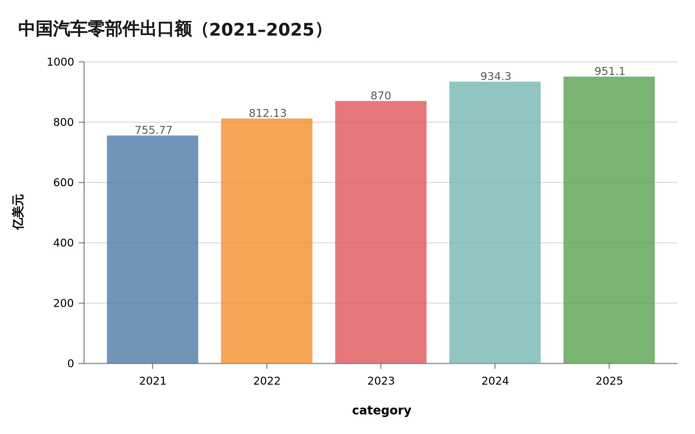
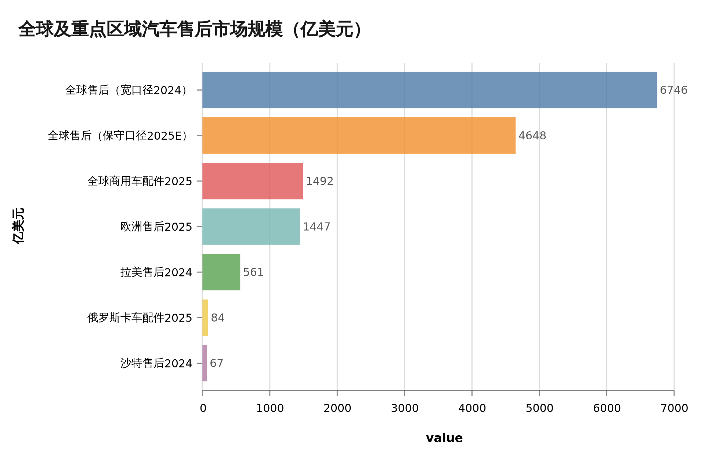
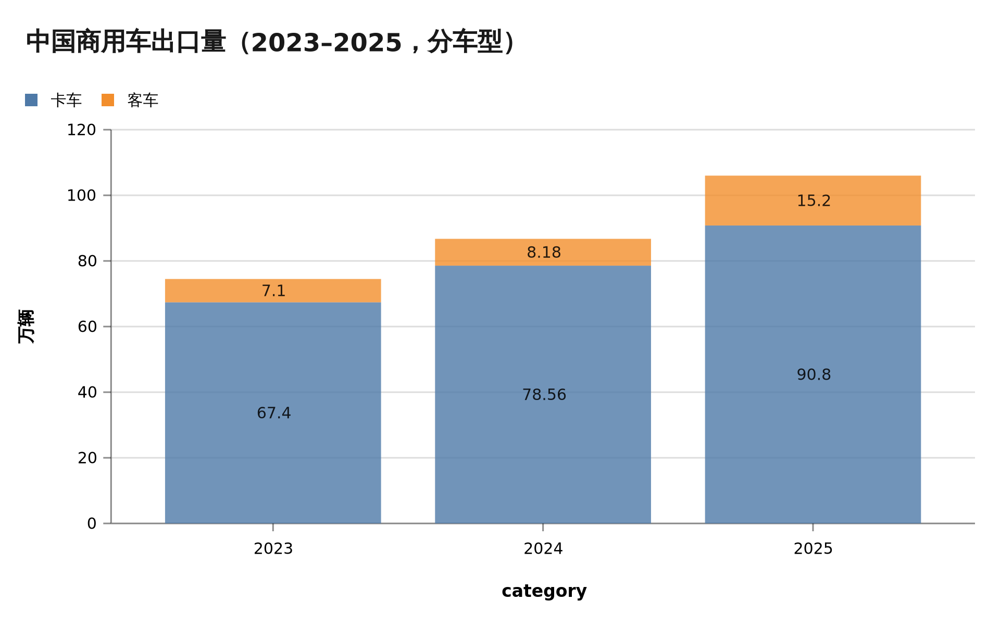
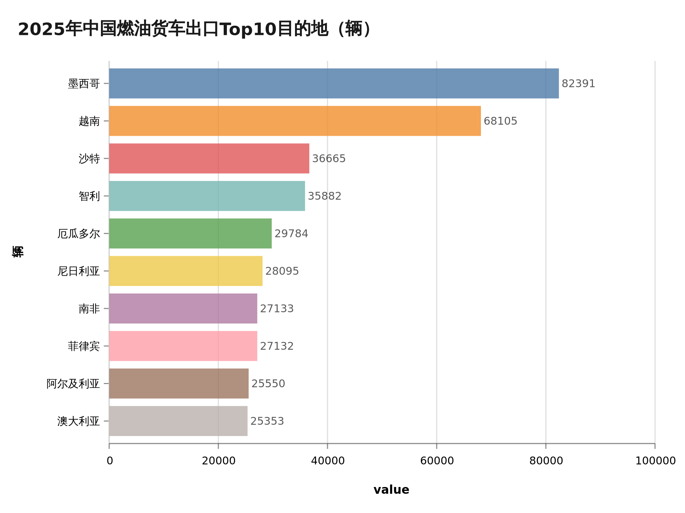
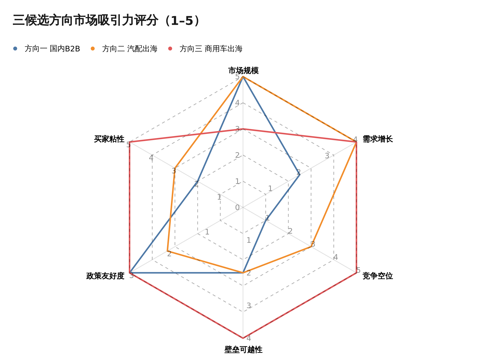

# B2B汽配交易系统可行性研究——市场规模与竞争格局评估报告

> 修订：2026-10-24 按《[docs/research/04-方向三商用车出海配件复核评估报告.md](research/04-方向三商用车出海配件复核评估报告.md)》修正数据口径（对俄出口降幅、货车增速、期间错配等），补充方向三 SAM/SOM 自建测算与 2026 年数据，并为弱来源添加标注。

## 摘要

本研究针对拟新建的 B2B 汽配交易系统，对三个候选方向开展市场可行性的桌面研究：**方向一**，国内市场，国内汽配商向维修企业供货；**方向二**，跨境出海，以英文平台连接中国零部件厂商与海外当地维修企业；**方向三**，商用车出海，聚焦中国商用车企在海外市场的配件销售，买家为当地维修企业、车队与大客户。基于 2026 年 10 月前公开可得、来源可溯的数据，核心结论如下：

第一，**方向一市场体量大（配件流通约 0.85–1.3 万亿元）但已进入洗牌期**。头部平台十年累计融资约 150 亿元仍无一家实现稳定规模盈利，买家基本盘（修理厂）两年半内缩减 18.7%，新能源车渗透正结构性压缩传统配件需求，新进入者此时入局面临在位者、价格战与需求转型三重挤压。

第二，**方向二顺风最强、天花板最高**。中国零部件出口额 2025 年达 951.1 亿美元（+2%，高关税下仍创新高），全球售后市场保守口径约 4,648 亿美元；"中国车海外保有量进入过保期"是未来五年的结构性红利（俄罗斯中国件份额已超 50%）。但该方向战线最宽：TecDoc 车型数据、E-mark/DOT 认证、海外仓物流与美欧高关税构成层层壁垒，且欧美维修厂线上采购心智弱（美国独立修理厂公开网站采购占比仅 6.9%）。

第三，**方向三痛点最尖锐、竞争格局最空白**。中国商用车出口三年从 58.2 万辆增至约 106 万辆（2026 年上半年再增 32.5%），海外保有量快速堆积，而配件交付周期在俄罗斯长达 2 周至 6 个月（单一市场证据，俄以外待一手验证）；监管已警示"卖得快、修得慢"。全球商用车配件市场约 1,492 亿美元仅为 TAM 上界，按海外保有量自建测算的可服务市场约 25–40 亿美元/年（2026E，见 4.1 节）；目前无一家主导性第三方平台，但"空白"存在 OEM 利润池、质保锁定等结构性成因，市场由 OEM 自建体系、出口贸易商、当地批发商碎片化分食，买家（车队/大客户）合同制采购、粘性强。

**综合建议：以方向三为切入（首选俄语区与中东/东南亚），平台底座按方向二的通用架构设计，验证后横向扩展至乘用车配件出海；不建议投入方向一。** 上述判断基于公开资料，关键假设（OEM 合作意愿、车队采购决策链、真实交付时效）需按第 5.3 节清单开展一手验证。

## 1. 研究背景与方法

### 1.1 三个候选方向界定

委托方拟新建 B2B 汽配交易系统，处于可行性研究阶段，候选方向三个：其一，面向国内市场，供应商为国内汽配商，买家为国内维修企业（修理厂）；其二，面向海外市场，以英文版平台服务中国出海零部件厂商，将中国产汽车配件（含新能源汽车配件）销售给配件所在国的维修企业；其三，更加聚焦，服务中国出海的商用车企（卡车、客车），面向当地维修企业、车队、大客户销售配件。三个方向共享"配件 B2B 交易"的业务内核，但在买家画像、地域市场、竞争格局与政策环境上差异显著，故分向评估。

### 1.2 研究方法、数据来源与局限

本研究采用桌面研究方法，于 2026 年 10 月通过中英文混合网络检索完成，共执行约 110 次检索与网页抓取，数据点均标注来源 URL 与数据年份，完整调研纪要归档于 `docs/research/` 目录（三份）。数据来源包括：官方统计（公安部、海关总署口径转引、中汽协）、上市公司文件（港交所招股书与年报）、咨询机构报告（罗兰贝格、灼识、Mordor、MarketsandMarkets）、行业媒体（财新、证券时报、21 经济网、AC汽车、卡车之家）及海外本地信源（Autostat、Kommersant、Reuters）。

研究局限需 upfront 说明：其一，"汽车后市场"统计口径差异极大（窄口径维保约 1.2–1.9 万亿元，宽口径含二手车金融超 6 万亿元），本研究统一采用窄口径并标注机构来源；其二，非上市平台营收多为管理层或媒体口径，无审计数据；其三，中国商用车海外保有量无权威统计，方向三的市场规模仅能给出上下界框架而非精确值；其四，本研究为桌面研究，未包含买家访谈与渠道实地验证，相关假设清单见第 5.3 节。

## 2. 方向一评估：国内汽配B2B供应链平台

### 2.1 市场规模与增长：大而缓

| 指标 | 数值 | 年份 | 来源 |
|---|---|---|---|
| 汽车后市场（维保口径） | 1.2 万亿元 → 1.9 万亿元（2027E），CAGR 约 5% | 2022→2027E | [罗兰贝格](https://www.rolandberger.com/publications/publication_pdf/AFTERMARKET.pdf) |
| 独立售后市场 | 1.24 万亿元 → 1.93 万亿元（2027E），CAGR 9% | 2022→2027E | [灼识咨询（转引）](https://pdf.dfcfw.com/pdf/H3_AP202401181617675345_1.pdf) |
| 配件流通规模（推算） | 约占售后产值 70%，即 0.85–1.3 万亿元 | 2023–2025 | [中国汽车流通协会](https://www.qichewuliu.com) |
| 汽车保有量 | 约 3.66 亿辆（新能源汽车占 12.01%） | 2025 底 | [公安部](https://www.mps.gov.cn/n2254314/n6409334/c10383533/content.html) |
| 燃油乘用车平均车龄 | 8.2 年（7 年以上老车占比近六成） | 2025 | [中汽协×和君咨询](https://auto.ifeng.com/c/8olB4GQLDnI) |
| 传统汽修门店 | 42.3 万家 → 34.4 万家（-18.7%） | 2023→2025 | [中国青年报](http://auto.cyol.com/gb/articles/2025-07/08/content_nydjlySwGO.html) |
| 新能源单车维保价值 | 较燃油车低约 30% | 2025 | [21经济网](https://www.21jingji.com/article/20250820/herald/6278bce2db69b6a25da5a1cbca91fa43.html) |

市场基本盘的判断是"大而缓"：约万亿元级的配件流通盘子足够容纳多个平台，但增速已降至个位数（5–9%）。支撑因素是车龄——燃油乘用车平均车龄升至 8.2 年，老车进入易损件与全车件的集中更换期；拖累因素有三：买家数量收缩（修理厂两年半减少 18.7%，独立后市场门店预计从 58 万家缩至约 45 万家）、新能源替代（新车渗透率 47.9%，保有量 4,397 万辆但平均车龄仅 1.8 年，其配件放量要等 3–5 年后）、以及新能源配件渠道被车企授权体系把控（尽管 2025 年国家指导意见要求开放三电配件供给渠道，落地节奏仍不明朗）。对一个以"抽佣或自营差价"为收入模型的 B2B 平台而言，市场增长红利有限，增长只能来自对存量渠道（汽配城、区域代理）的替代，而替代战正是过去十年头部平台打的仗。

### 2.2 竞争格局：十年混战后的洗牌期

| 公司 | 模式 | 规模与状态 |
|---|---|---|
| 途虎养车（9690.HK） | 加盟工场店+B2b供应链 | 2025 营收 165 亿元（+11.5%），8,008 家门店；经调净利率约 4%；市值较上市蒸发超 50%（[港交所](https://www1.hkexnews.hk/listedco/listconews/sehk/2026/0320/2026032000835_c.pdf)、[新浪财经](https://finance.sina.com.cn/stock/aigcy/2026-07-02/doc-inifmmmw4155357.shtml)） |
| 新康众/天猫养车 | 自营仓配+加盟连锁 | D 轮估值约 50 亿美元（媒体口径）；2025 年高层内斗公开化，约 1,300 家直营店转"新合伙店"（[汽车服务世界](https://asworld.cn/sys-nd/1932.html)） |
| 开思（CASVI） | 全车件平台撮合+SaaS | GMV 76 亿元（2025，+31%）；3 年累亏超 14 亿元；2026 年 4 月递表港交所；原厂件毛利率仅 0.9%（[招股书](https://www1.hkexnews.hk/app/sehk/2026/108408/documents/sehk26040203408_c.pdf)、[21经济网](https://www.21jingji.com/article/20260417/herald/8c0cc2c97e5b4f118b6c025eb054aeaa.html)） |
| 快准车服 | 易损件自营+服务站 | 2021 年营收 36 亿元；2025 年 80–100 亿元目标达成未披露（[AC汽车](https://acqiche.com/archives/39980.html)） |
| 三头六臂 | 自有品牌易损件连锁 | 门店 3,100+；公开融资累计超 4 亿元后多年未融资（[DoNews](https://www.donews.com/article/detail/6672/81457.html)） |
| 京东养车 | 电商+门店 | 2025 年门店破 4,000 家（媒体口径），财务不单独披露 |
| 中驰车福 | 线上汽配商城 | 2024 年纳斯达克上市，15 个月后收摘牌通知，股价跌约 99%（[证券时报](https://stcn.com/article/detail/1325427.html)） |
| 甲乙丙丁 | 轮胎切入 B2B | 累计融资约 10 亿元，2025 年疑似爆雷、加盟商维权（[腾讯新闻](https://news.qq.com/rain/a/20250731A01RAA00)） |
| 新瑞立 | 商用车配件直营 | 2025 年收入 25.04 亿元（-7.8%），净利率 2.8%，递表港交所（[招股书](https://www1.hkexnews.hk/app/sehk/2026/108685/documents/sehk26062601709_c.pdf)） |

竞争格局的证据链高度一致：这是一个资本密集投入十年后仍未跑通盈利模型的赛道。头部三家平台累计融资约 150 亿元（[搜狐](https://www.sohu.com/a/860048845_99995202)），但唯一大规模上市样本途虎净利率仅约 4% 且上市后市值腰斩；开思招股书揭示的模型困境更具代表性——占收入 70% 以上的原厂件自营业务毛利率仅 0.9%，高毛利（92%）的只有平台/SaaS 业务本身；中驰车福与甲乙丙丁的结局则说明纯线上撮合与重资产自营两端都有失败样本。同时应当公允地看到，行业出清本身在为幸存者让出空间：汽配城在多地被系统性整顿关停，修理厂数量收缩但连锁化率预计 2025 年升至 29%，供给端整合的逻辑仍在。问题在于，此时入场的新玩家没有资金与网络的先发优势，将直接与"已烧完 150 亿元学费"的在位者正面竞争，而行业利润率仍在下行（汽车行业利润率 2021 年 6.1% → 2026Q1 3.2%，[EET-China](https://www.eet-china.com/mp/a528076.html)）。

### 2.3 结构性变数：新能源对独立售后的挤压

新能源是方向一的长期最大变数。利好侧：新能源维保产值从 2020 年 91 亿元增至 2025E 904 亿元，三电维保 2025 年约 450 亿元，行业称 2025 年为"过保业务元年"（[21经济网](https://www.21jingji.com/article/20250820/herald/6278bce2db69b6a25da5a1cbca91fa43.html)）。利空侧：新能源单车维保价值低 30%，意味着同等保有量下配件盘更小；更关键的是渠道结构——三电核心件的技术标准、诊断协议与授权体系掌握在车企与电池厂手中，2025 年虽有国家层面开放供给渠道的指导意见，但海外已有反面案例（5 家中国车企因未向澳大利亚独立维修商开放诊断软件被监管警告），国内部分品牌仍通过技术封锁限制第三方（[汽车服务世界](https://asworld.cn/sys-nd/2771.html)）。新能源配件的放量期在 3–5 年后，届时渠道归属（车企授权体系 vs 独立售后）尚无定论，新平台现在入场难以卡位。

> **方向一小结**：市场大、增长缓、竞争烈、格局正在出清——这是一个"好行业里的坏时机"。对缺乏供应链资源与资金厚度的新进入者，方向一不具备可行性；即便进入，合理姿势也是等待出清后的整合并购，而非新建平台从零起步。

## 3. 方向二评估：汽配跨境出海B2B平台

### 3.1 市场规模：出口基本盘与中国车保有量红利

| 指标 | 数值 | 年份 | 来源 |
|---|---|---|---|
| 中国零部件出口额 | 755.77 → 812.13 → 约870 → 934.3 → 951.1 亿美元（2021–2025） | 2021–2025 | [中汽协/海关（转引）](https://www.yicai.com/news/103041131.html)、[Gasgoo](https://autonews.gasgoo.com/articles/news/china-auto-parts-strong-export-resilience-why-the-import-rebound-2053873051219939329) |
| 零部件贸易顺差 | 426 亿美元（+19.9%），全球第一大出口国 | 2025 | [WorldsTopExports](https://www.worldstopexports.com/automotive-parts-exports-country) |
| 全球售后市场 | 4,648.3 亿 → 5,558.2 亿美元（2030E，保守口径） | 2025→2030 | [Mordor](https://www.mordorintelligence.com/industry-reports/automotive-aftermarket-market) |
| 全球汽配电商售后 | 2,239.3 亿美元（2023），CAGR 13.24% | 2023 | [GMI](https://www.gminsights.com/industry-analysis/e-commerce-automotive-aftermarket) |
| 俄罗斯中国件份额 | 占俄售后市场超 50%；俄自华进口配件 2026 前 7 个月约 13 亿美元（+15%） | 2024–2026 | [Kommersant/Meduza](https://meduza.io/en/news/2026/08/11/chinese-auto-parts-deliveries-to-russia-up-15-over-seven-months-kommersant-reports) |
| 俄罗斯中国品牌车保有量 | 约 236 万辆（全车型） | 2025 初 | [OFweek（汇总）](https://nev.ofweek.com/2026-05/ART-71011-8480-30687958.html) |
| 比亚迪海外销量 | 104.96 万辆（+145%） | 2025 | [21财经](https://www.21jingji.com/article/20260325/herald/3b7f188fe1d4a3d5b1e256f5a8a0330a.html) |

供给侧的确定性极高：中国零部件出口四年间从 812 亿增至 951 亿美元（CAGR 约 5.3%），在美欧高关税下仍创新高，且出口结构正从欧美转向俄罗斯、中亚、中东、拉美、东南亚。需求侧的最大增量是"中国车保有量"：俄罗斯 236 万辆中国品牌车已进入配件更换期（直采中国原厂件比俄本地购买便宜 30–50%），比亚迪 2025 年海外销量破百万辆，中东、中亚、东南亚车队正陆续过保——中国产配件的"原厂替代件+品牌件"需求是未来五年的结构性红利，行业评论普遍认为其规模将超过整车出口本身（[Nexus Automotive](https://www.facebook.com/nexusautomotive/posts/1635228048395362)）。需要正视的是区域分化：全球售后规模中美国（约 5,350 亿美元，Auto Care 宽口径）与欧洲（1,447 亿美元）体量最大，但恰是对中国件政策与心智阻力最大的市场；接受度最高的俄语区、中东、东南亚单体规模较小，属于"易攻之地先易守"的选择题。

### 3.2 竞争格局：平台层空位与渠道壁垒

现有玩家分布揭示了明确的空位。跨境 B2B 平台（阿里国际站、Made-in-China、环球资源）停留在**获客层**而非交易履约层——36氪调研指出汽配出海交易大量在线下完成；阿里国际站汽配类目 GMV 绝对值未公开，仅有东南亚汽配品类交易额同比 +533% 等结构性信号。海外买家端的在线渠道被两类玩家占据：面向 C 端/DIY 的电商（eBay Motors 汽配类年 GMV 超 100 亿美元、欧洲 Autodoc 2025 年营收 18 亿欧元、美国 RockAuto），以及本地分销体系（美国四大连锁、LKQ、Nexus 网络）。中国出海服务商则集中于卖家侧：常州凌越（碰撞件，2022 年营收 1.57 亿美元，亚马逊+自营美国仓）、扬腾创新（B2 轮 2.7 亿元，腾讯/顺为/高瓴投资，正筹备上市）、VIOMALL（北美一件代发基础设施）——**尚无一家形成规模的"中国厂商→海外维修厂"交易型 B2B 平台**。买家行为数据解释了空位存在的原因：美国独立维修厂从公开网站采购的配件占比仅 6.9%，且从 2020 年的 12.0% 不升反降（[IMR](https://www.automotiveresearch.com/insights/auto-repair-shops-ecommerce-purchasing-behavior)）——修理厂依赖本地批发商的即时配送与赊销，纯线上商城对"修车等件"场景替代性有限；而俄罗斯车主线上购买汽配比例约 55%、线上心智成熟，对中国件零抵触。这意味着方向二的可行性高度依赖目的地选择：在俄语区/中亚/中东/东南亚做 B2B 平台顺水推舟，在美欧则是与 Autodoc、LKQ 及本地分销正面战争。

### 3.3 进入壁垒与政策风险

壁垒按强度排序：**其一，车型适配数据**。欧洲售后的事实标准是 TecDoc/TecAlliance（K-type 体系），北美是 ACES/PIES，许可费均为报价制、无公开价格，构成中国平台的第一道门槛，也是 Autodoc 等在位者的核心护城河之一。**其二，关税与贸易政策**。美国 301 关税零部件 25% 叠加 IEEPA 20% 与 232 零部件 25%（2025 年 5 月生效），综合税负可达 50% 以上（[White & Case](https://www.whitecase.com/insight-alert/united-states-finalizes-section-301-tariff-increases-imports-china)、[ST&R](https://www.strtrade.com/trade-news-resources/tariff-actions-resources/section-232-tariffs-automobile-parts)）；欧盟对华 BEV 反补贴税最高合计约 45.3%（零部件暂未被覆盖）；墨西哥 2026 年起对华整车关税升至 50%、零部件 7–36%。**其三，知识产权**。碰撞件等外观件常被 OEM 注册外观设计专利，产品带 OEM 标识即构成假冒，eBay VeRO/亚马逊先行下架。**其四，认证**（E-mark/DOT，费用无公开价目，量级为每产品族数千至数万美元）。**其五，大件物流**——需海外仓与拆分式设计（凌越的"积木化"方案可将价格做到美国线下的 1/2–1/3）。上述壁垒意味着方向二是重资源投入：车型数据库、合规认证、海外仓网络三项固定投入缺一不可，回收周期长，但一旦建成即形成后来者难以复制的数据与履约资产。

> **方向二小结**：天花板最高的方向——出口基本盘 951 亿美元且仍在增长，中国车海外保有量红利刚刚开始释放，平台层存在经买家行为数据验证的真实空位。但它是"重资产、长周期"的打法，成败取决于目的地市场的取舍（俄语区/中亚/中东/东南亚优先，美欧后置）与车型数据、海外仓两项核心资产的构建速度。

## 4. 方向三评估：商用车出海配件平台

### 4.1 市场规模：出口放量与保有量堆积

| 指标 | 数值 | 年份 | 来源 |
|---|---|---|---|
| 商用车出口量 | 58.2 万 → 90.4 万 → 约 106 万辆（2022–2025，首破百万） | 2022–2025 | [中国经济网](http://cv.ce.cn/news/202602/t20260211_2768262.shtml)、[第一财经](https://www.yicai.com/news/102448435.html) |
| 其中重卡 | 29.51 万辆（2024）→ 约 34 万辆（2025） | 2024–2025 | [中国工业报](https://www.cinn.cn/yw/2025/02-17/V1Qe5881.html) |
| 全球商用车配件市场 | 约 1,492 亿美元（2025）→ 2,500–3,000 亿美元（2035E） | 2025 | [eBay 报告（引 Credence）](https://www.prnasia.com/story/526131-1.shtml) |
| 俄罗斯卡车配件市场 | 约 84 亿美元（销售额 7,750 亿卢布，+10.2%） | 2025 | [Autostat](https://m.autostat.ru/infographics/60473)、[TAdviser](https://tadviser.com/index.php/Article:Trucks_(Russian_market)) |
| 俄罗斯中国品牌配件市场 | 超 500 亿卢布 | 2025 | [Tradesoft](https://www.tradesoft.ru/knowledge/kakie-zapchasti-dlya-kitaytsev-realno-pokupayut-v-2025) |
| 俄罗斯中国品牌卡车保有量 | 20.5 万辆（占俄卡车保有量 5.7%） | 2024.1 | [Autostat](https://m.eng.autostat.ru/news/24417) |
| 中国重汽海外后市场 | 配件收入同比 +59%；2030 年目标 10 亿美元 | 2025 | [新华网](http://sd.news.cn/20251021/956d936db1f840ff85172ec73c2f8b05/c.html) |
| 商用车出口量（2026上半年） | 66.4 万辆（+32.5%），增速较 2025 年扩大 | 2026H1 | [中汽协（转引）](https://wap.seccw.com/index.php/Index/detail/id/47669.html) |
| 可服务市场（SAM，自建测算） | 中国品牌商用车海外保有量约 430 万辆（2021 年以来出口累计约 440 万辆×在用率 85%，加前期存量）×单车年配件消耗 ≈ **25–40 亿美元/年**（2026E，年增 25–30%）；其中俄罗斯分市场约 3–5 亿美元/年 | 2026E | 自建模型，详见 [04 号复核报告](research/04-方向三商用车出海配件复核评估报告.md)第四章 |

注：2022 年出口总量 58.2 万辆（未获分车型数据）；2024 年卡车+客车合计 86.74 万辆与总量 90.4 万辆的差异源于底盘等分类口径；目的地结构显示对俄依赖已显著下降（墨西哥、越南、沙特为 2025 年前三）。2026-10 复核勘误：2025 年货车出口增速应为 +16.7%（原引 +34% 系崔东树海关口径误配）；对俄整车出口 2025 年约 58.3 万辆、降幅约 -50%（原引 -58% 系月度累计口径误植）；俄卡车配件市场 84 亿美元为 Autostat 2024 年数据。

方向三的市场逻辑与方向二同源但更陡峭：商用车（尤其重卡、客车）是生产资料，停运即损失，车队对配件可得性的支付意愿远高于乘用车车主；且中国商用车出口三年接近翻倍，2025 年首破百万辆，海外保有量正处于快速堆积期。全球商用车配件市场 1,492 亿美元仅为 TAM 上界（含全球全品牌全渠道）；按"海外保有量×单车年配件消耗"自建测算，本方向可服务市场（SAM）约 25–40 亿美元/年（2026E）。锚点清晰：仅俄罗斯一国卡车配件市场即 84 亿美元（2024 年，Autostat），其中中国品牌对应约 3–5 亿美元/年；而中国重汽一家给自己定下的 2030 年海外后市场收入目标是 10 亿美元——既说明 OEM 已把配件确认为下一个利润池，也提示一家 OEM 的目标即约等于全球 SAM 的 1/4–1/3，第三方独立空间主要在非 OE 件与 OEM 覆盖缺口（测算过程见 [04 号复核报告](research/04-方向三商用车出海配件复核评估报告.md)第四章）。

### 4.2 竞争格局：碎片化三类玩家与 OEM 自建竞赛

截至 2026 年 10 月的检索未发现任何一家占据主导地位的、专注中国商用车海外售后的第三方 B2B 配件平台（Tracxn 收录的全球 73 家 B2B 汽配创业公司中无一聚焦此细分）。实际竞争来自三类玩家：**OEM 自有体系**——重汽计划建 63 个海外配件中心库并前置 5,000 万美元配件，宇通海外授权服务网点 400+ 家并建三级配件储备，福田拥有 18 个区域配件中心、服务网络 1,200+；**出口贸易商**——济南/山东集群的 Sinosoon、HowoParts 等，混柜拼单、拼价格、无服务能力；**当地批发商**——俄罗斯 Deruna 自称两年内拿下俄 SITRAK 配件约 35% 份额（自述数据、无第三方佐证），显示当地渠道的区位优势——该案例同时印证"本地仓+分销"是当前赢家模型，对纯线上跨境撮合平台构成警示。格局碎片化的另一面是痛点尖锐：俄罗斯市场中国卡车备件交付周期 2 周至 6 个月（[卡车天地](https://www.cntplus.com/truck/214109.html)；单一来源且为禁售前数据，2025 年俄渠道去库存后可能已缓解，俄以外市场无量化数据），配件短缺甚至催生"拆车件"灰产（[shev.io](https://shev.io/zh/news/russia-car-cannibalization-parts-shortage)）；财新报道监管层已警示中国车企海外"卖得快、修得慢"损害品牌口碑（[财新](https://m.caixin.com/m/2026-09-20/102488083.html)）。对平台切入而言，OEM 自建体系既是最大的潜在竞争者，也是潜在的合作方——自建 63 个中心库的重资产模式慢且贵，第三方平台若能以"OEM 授权+平台化履约"方式承接其配件长尾与下沉需求，存在竞合空间。买家侧（车队、大客户、维修企业）为合同制采购，海外车队买家已在购车合同中争取"48 小时配件发运"条款，支付意愿与粘性俱佳。

### 4.3 政策与风险

方向三的政策风险集中于俄罗斯：报废税 2024 年 10 月起上调 70–85% 且逐年指数化上涨，2025 年 7–8 月禁售 4 品牌 12 款车型（合计占俄卡车市场 27.6%），直接导致 2025 年中国对俄整车出口约 -50%（约 58.3 万辆；原引 -58% 系月度累计口径误植，见 04 号复核报告 E3）、俄卡车销量 -53%（[TAdviser](https://tadviser.com/index.php/Article:Trucks_(Russian_market))）。另需动态跟踪：2026 年对俄整车出口出现恢复性反弹（媒体报道前 8 个月约 68.8 万辆、已超 2025 全年，待权威口径核实），"增量转存量"的判断需随之修正。但需辨析：报废税与禁售打击的是**新车增量**，反而将市场推向**存量保有主导**——20.5 万辆中国卡车与 236 万辆中国汽车的保有量转向配件与维修需求，强化而非削弱后市场逻辑。真正需要布局的合规能力是：EAC/TR CU 018/2011 认证，以及 2026 年 12 月起俄罗斯对汽配实施"诚实标识"（Честный знак）强制赋码。第二梯队风险是本地化趋势：墨西哥 50%、巴西 35% 的整车关税推动 KD 组装本地化，未来配件需求形态将从"整车出口带件"转向"KD 件+本地化供应链"，平台若能卡位 KD 件供应环节则受益于该趋势。第三是集中度风险：俄罗斯单一市场波动大（2025 年即为实例），需以目的地多元化对冲——2025 年货车出口前十里墨西哥、越南、沙特、智利、厄瓜多尔、尼日利亚等已接棒俄罗斯，市场分散化本身降低了单一政策冲击。

> **方向三小结**：三个方向中"胜率最高"的选择——需求确定性（保有量堆积+生产资料属性）、痛点尖锐度（交付 2 周起）、格局空白度（无主导平台）、买家质量（车队/大客户合同制）四项俱佳；市场规模小于方向二，但作为切入切口足够，且与方向二共享平台底座。核心风险是俄罗斯政策与 OEM 自建的排挤，应对分别是合规前置与竞合设计。

## 5. 综合比较与方向建议

### 5.1 六维评分与比较

评分说明：六维均为分析师定性评分（1–5 分，5 为最优），依据为本报告第 2–4 章的证据链，非量化指数。TAM/SAM 框架对照如下：

| 维度 | 方向一 国内B2B | 方向二 汽配出海 | 方向三 商用车出海 |
|---|---|---|---|
| TAM（总市场） | 配件流通 0.85–1.3 万亿元 | 全球售后 4,648–6,746 亿美元 | 全球商用车配件 1,492 亿美元（TAM 上界，含全球全品牌全渠道） |
| SAM（可服务市场） | 平台可触达的独立售后配件盘（无权威口径） | 中国件可参与的市场：俄语区/中东/东南亚/拉美（俄中国件份额已超 50%） | 约 25–40 亿美元/年（2026E，自建测算：保有量约 430 万辆×单车消耗；锚点：俄卡车配件 84 亿美元/2024，其中中国品牌约 3–5 亿美元） |
| SOM（可获得市场） | 受制于在位者网络与价格战 | 取决于目的地选择与数据/仓储投入 | 取决于 OEM 合作与 1–2 个首发市场验证；对应"中型垂直生意"量级（GMV 数亿美元），非平台估值叙事 |
| 竞争烈度 | 极高（150 亿元学费的在位者） | 中（平台层空位，渠道层坚固） | 低（无主导平台；但空白可能结构性无利可图——OEM 利润池、质保锁定、本地服务壁垒，见 04 号复核报告 Q2） |
| 核心壁垒 | 供应链网络与资金 | TecDoc 数据、认证、海外仓、关税 | OEM 关系、本地合规（EAC/赋码） |
| 首要风险 | 需求萎缩+盈利模型未验证 | 美欧关税与买家线上化率低 | 俄政策波动、OEM 自建排挤 |

雷达图的形态差异直观呈现了三个方向的取舍：方向一仅在"市场规模"一项取到满分，竞争与增长双弱；方向二规模与增长兼备但壁垒难越、政策承压；方向三在竞争空位、壁垒可越性与买家粘性三项领先，仅在市场规模上让位。这不是"谁分数高"的问题，而是资源投放顺序问题——方向三以更小的 TAM 换取更高的成功概率与更快的验证周期，且其积累的车型数据、跨境履约与本地合规资产可直接复用于方向二的横向扩张。

### 5.2 推荐路径

**建议以方向三为首发切入，方向二为第二阶段扩张，不投入方向一。** 具体路径：第一步（0–6 个月）选择 1–2 个首发市场——俄语区（俄罗斯/哈萨克斯坦，保有量密度最高、线上心智成熟、中国件零抵触）+ 中东（沙特/阿联酋，重汽/安凯/宇通保有量大、政策阻力小）或东南亚（越南/菲律宾/印尼，2025 年出口放量市场）——完成买家侧验证：车队与维修企业的采购决策链、真实交付时效、现有渠道价格体系。第二步（6–18 个月）绑定 1–2 家 OEM 或其一级经销商作为供给侧锚点（重汽、陕汽、宇通均有后市场收入考核压力），以"OEM 授权件+平台化履约"模式跑通单品类的交易闭环。第三步（18 个月以后）将车型库、跨境交易与多语言底座横向扩展至乘用车配件（即方向二），优先俄语区与中东，美欧市场在 TecDoc 数据与海外仓就绪前不进入。方向一不建议投入的原因已如第 2 章所述；若未来国内出现整合并购窗口，可作为财务性机会单独评估。

### 5.3 需一手验证的关键假设

本研究为桌面研究，以下假设决定上述推荐是否成立，须在立项决策前通过访谈与实地渠道验证：

1. **OEM 合作意愿**：重汽、陕汽、宇通等是否愿意授权第三方平台销售其海外配件（而非全部自建）？其海外配件中心库的建设进度与覆盖缺口有多大？
2. **买家决策链**：海外车队/大客户的配件采购由谁决策（车队长/老板/本地维修厂）？框架协议、账期与交付时效的真实要求是什么？
3. **现有渠道价格体系**：Deruna 类当地批发商与济南贸易商的实际加价率、交期与服务水平，平台切入的价差空间有多大？
4. **合规成本**：EAC 认证与俄罗斯 2026 年 12 月配件强制赋码的实操成本与周期；TecDoc 数据许可的实际报价（若未来进入欧洲）。
5. **交付时效**：俄罗斯以外市场（中东、东南亚）中国商用车配件的真实交付周期是否存在与俄罗斯同量级的痛点（公开数据缺口）。
6. **市场规模自建模型**：以"分国别中国商用车保有量×车龄结构×单车年配件消耗"构建 SAM 测算，替代当前仅有的上下界锚点。

## 6. 结论

三个候选方向共享配件 B2B 交易的内核，却处于截然不同的市场生命周期。方向一所在的国内市场是一个万亿级但增长趋缓、竞争者用十年与百亿级资金仍未跑通盈利模型的出清期市场，买家基盘萎缩与新能源渠道收权构成双重长期压制，新进入者缺乏可识别的差异化生存空间。方向二所指向的跨境市场具备最强的结构性顺风——951 亿美元的出口基本盘叠加以俄罗斯 236 万辆中国车为代表、正在进入过保期的海外保有量红利，且"中国厂商到海外维修厂"的交易型平台层确实空缺，但车型数据、认证、海外仓与美欧关税使其成为一项重资产、长周期的工程，目的地选择决定其短期生死。方向三在需求确定性、痛点尖锐度、竞争空白度与买家质量四个维度同时占优，全球 1,492 亿美元的商用车配件 TAM 上界虽小于乘用车售后（本方向可服务 SAM 约 25–40 亿美元/年，属利基但年增 25–30% 的市场），但其生产资料属性带来的配件支付意愿与车队合同制粘性，为新平台提供了最短验证路径；其风险——俄罗斯政策波动与 OEM 自建排挤——均有可设计的对冲手段（目的地多元化与竞合绑定）。市场的客观事实是：中国汽车产业的价值重心正沿"整车出口→保有量→售后配件"的链条后移，而三条链条上目前都还没有属于第三方的交易平台；先行者的窗口存在于最聚焦、痛点最深的那一环。

## 7. 参考文献

[1] 罗兰贝格. 中国汽车后市场白皮书[EB/OL]. https://www.rolandberger.com/publications/publication_pdf/AFTERMARKET.pdf, 2023.
[2] 公安部. 2025年全国机动车与驾驶人统计[EB/OL]. https://www.mps.gov.cn/n2254314/n6409334/c10383533/content.html, 2026-01-27.
[3] 中汽协, 和君咨询. 2025中国汽车后市场年度发展报告[EB/OL]. https://auto.ifeng.com/c/8olB4GQLDnI, 2025-12.
[4] 开思时代. 香港交易所招股说明书[EB/OL]. https://www1.hkexnews.hk/app/sehk/2026/108408/documents/sehk26040203408_c.pdf, 2026-04-02.
[5] 途虎养车. 2025年年度业绩公告[EB/OL]. https://www1.hkexnews.hk/listedco/listconews/sehk/2026/0320/2026032000835_c.pdf, 2026-03-20.
[6] 新瑞立. 香港交易所招股说明书[EB/OL]. https://www1.hkexnews.hk/app/sehk/2026/108685/documents/sehk26062601709_c.pdf, 2026-06-26.
[7] 中国青年报. 传统汽修门店数量变化报道[EB/OL]. http://auto.cyol.com/gb/articles/2025-07/08/content_nydjlySwGO.html, 2025-07-08.
[8] DoNews. 汽配平台进入第十年[EB/OL]. https://www.donews.com/article/detail/6672/81457.html, 2025-02.
[9] 第一财经（引中汽协）. 2025年汽车零部件出口数据[EB/OL]. https://www.yicai.com/news/103041131.html, 2026.
[10] Gasgoo. China auto parts strong export resilience[EB/OL]. https://autonews.gasgoo.com/articles/news/china-auto-parts-strong-export-resilience-why-the-import-rebound-2053873051219939329, 2026-05.
[11] Mordor Intelligence. Automotive Aftermarket Market Report[EB/OL]. https://www.mordorintelligence.com/industry-reports/automotive-aftermarket-market, 2025-09.
[12] Auto Care Association. Auto Care Factbook 2025[EB/OL]. https://www.autocare.org/news/latest-news/details/2025/06/13/new-report-5.1-growth-expected-for-auto-care-industry-in-2025-reaching-$664-billion-in-2028, 2025-06-13.
[13] Autodoc Group. Annual Results Press Release[EB/OL]. https://autodoc.group/en/news-room/press-releases/autodoc-continues-to-grow-rapidly-in-2025, 2026-01.
[14] IMR AutomotiveResearch. Auto Repair Shops E-commerce Purchasing Behavior[EB/OL]. https://www.automotiveresearch.com/insights/auto-repair-shops-ecommerce-purchasing-behavior, 2024.
[15] Kommersant (via Meduza). Chinese auto parts deliveries to Russia up 15%[EB/OL]. https://meduza.io/en/news/2026/08/11/chinese-auto-parts-deliveries-to-russia-up-15-over-seven-months-kommersant-reports, 2026-08-11.
[16] White & Case. United States Finalizes Section 301 Tariff Increases[EB/OL]. https://www.whitecase.com/insight-alert/united-states-finalizes-section-301-tariff-increases-imports-china, 2024-09.
[17] Sandler Travis & Rosenberg. Section 232 Tariffs on Automobile Parts[EB/OL]. https://www.strtrade.com/trade-news-resources/tariff-actions-resources/section-232-tariffs-automobile-parts, 2025-05.
[18] European Commission. Countervailing Duties on BEV Imports from China[EB/OL]. https://trade.ec.europa.eu/access-to-markets/en/news/eu-commission-imposes-countervailing-duties-imports-battery-electric-vehicles-bevs-china, 2024-12.
[19] Reuters. Mexico to Raise Tariffs on Chinese Cars to 50%[EB/OL]. https://www.reuters.com/business/autos-transportation/mexico-raise-tariffs-cars-china-50-major-overhaul-2025-09-10, 2025-09-10.
[20] 中国经济网. 2025年商用车出口首破百万辆[EB/OL]. http://cv.ce.cn/news/202602/t20260211_2768262.shtml, 2026-02-11.
[21] 美通社（eBay报告）. 商用车配件出海新机遇[EB/OL]. https://www.prnasia.com/story/526131-1.shtml, 2026.
[22] Autostat. 俄罗斯卡车配件市场 infographic[EB/OL]. https://m.autostat.ru/infographics/60473, 2025.
[23] 新华网. 中国重汽全球合作伙伴大会报道[EB/OL]. http://sd.news.cn/20251021/956d936db1f840ff85172ec73c2f8b05/c.html, 2025-10-21.
[24] 财新. 中国车企海外售后服务警示报道[EB/OL]. https://m.caixin.com/m/2026-09-20/102488083.html, 2026-09-20.
[25] Tradesoft. 俄罗斯市场中国品牌配件分析[EB/OL]. https://www.tradesoft.ru/knowledge/kakie-zapchasti-dlya-kitaytsev-realno-pokupayut-v-2025, 2025.
[26] AC汽车. 常州凌越战略融资报道[EB/OL]. https://acqiche.com/archives/39715.html, 2023-10.
[27] 证券时报. 扬腾创新上市辅导备案[EB/OL]. https://stcn.com/article/detail/1839328.html, 2025-05.
[28] TAdviser. Trucks: Russian Market[EB/OL]. https://tadviser.com/index.php/Article:Trucks_(Russian_market), 2026.
[29] 卡车天地. 俄罗斯中国卡车配件市场调查[EB/OL]. https://www.cntplus.com/truck/214109.html, 2024.
[30] 崔东树. 2025年中国汽车出口结构分析[EB/OL]. https://www.shanqx.com/index.php?m=home&c=View&a=index&aid=3185, 2026.
[31] 崔东树. 2025年全年中国汽车出口市场分析[EB/OL]. https://auto.jgvogel.cn/c1577305.shtml, 2026-01-27.
[32] 经济观察报. 中国重汽2025销量达历史峰值 2030年冲击80万辆[EB/OL]. http://m.eeo.com.cn/2025/1218/773757.shtml, 2025-12-18.
[33] 中汽协（转引）. 2026年上半年中国汽车出口情况[EB/OL]. https://wap.seccw.com/index.php/Index/detail/id/47669.html, 2026-07-17.
[34] 本项目04号复核报告. 方向三商用车出海配件复核评估报告[EB/OL]. docs/research/04-方向三商用车出海配件复核评估报告.md, 2026-10-24.
